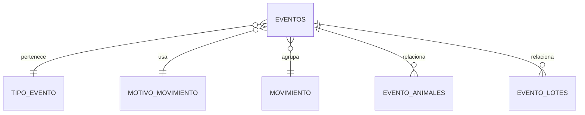
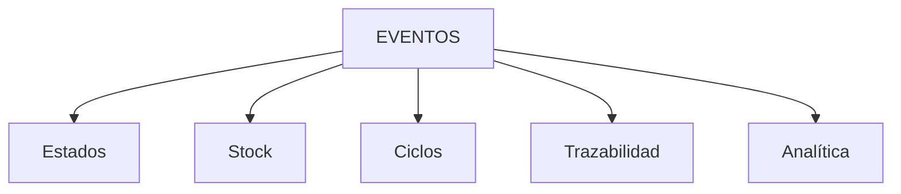
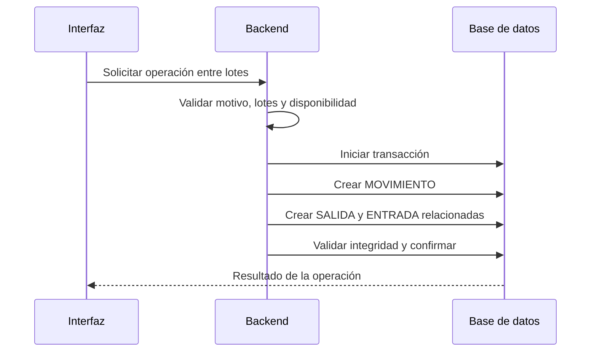
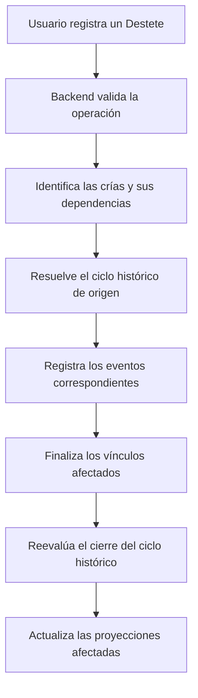

## 📄 `eventos.md`

# ⚡ Modelo de Eventos

## Filosofía central

El sistema es event-driven.

Todo hecho importante se representa mediante un evento.

Los eventos son:
- inmutables,
- históricos,
- auditables,
- trazables.

Los eventos constituyen la fuente de verdad de los hechos registrados. Los estados y las proyecciones representan interpretaciones derivadas de esos hechos y de las reglas del dominio.

No todo evento genera un cambio de estado, y no todo cambio de una proyección implica la creación de un nuevo evento.

---

# 🧠 Principio fundamental

```txt
Los EVENTOS son la única fuente de verdad.
```

Todo lo demás:
- estados,
- stock,
- dashboards,
- métricas,
- trazabilidad,

se deriva de eventos.

---

# 🧱 Qué es un evento

Un evento representa:

> algo que realmente ocurrió.

Ejemplos:
- parto
- cubrición
- muerte
- venta
- movimiento
- entrada de animales
- tratamiento sanitario

---

# 🧬 Estructura conceptual



---

# 📦 Tipos de eventos

| Tipo | Ejemplos |
|---|---|
| Reproductivos | cubrición, parto, aborto |
| Sanitarios | tratamiento, observación |
| Stock | entrada, salida, traslado |
| Económicos | venta |
| Sistema | ajustes, compensaciones |

---

# 🔒 Inmutabilidad

## Regla crítica

```txt
Un evento NO se edita.
Un evento NO se elimina.
```

---

## Correcciones

Las correcciones se realizan mediante:

```txt
eventos compensatorios
```

Ejemplo:

```txt
Entrada incorrecta
→ crear salida compensatoria
```

---

# 🔄 Flujo de derivación



Las proyecciones pueden incorporar reglas de dominio y relaciones entre entidades, además de los datos contenidos directamente en un evento.

Por ejemplo, la finalización de un ciclo histórico puede derivarse de la ausencia de dependencias madre-cría activas. Esta consecuencia no requiere crear un evento artificial de cierre.

Las operaciones de escritura deben preservar la coherencia entre los eventos registrados y las proyecciones actualizadas, aplicando las reglas del dominio y las garantías transaccionales correspondientes.

---

# 🧱 Relaciones de eventos

## EVENTO_ANIMALES

Relaciona:

```txt
evento ↔ animales
```

---

## EVENTO_LOTES

Relaciona:

```txt
evento ↔ lotes
```

---

## MOVIMIENTO

Agrupa eventos coordinados.

Ejemplo:

```txt
salida lote A
entrada lote B
```

---

# 🔄 Movimiento entre lotes

## Concepto

Un movimiento entre lotes representa una operación de negocio que cambia la pertenencia de uno o varios animales a sus agrupaciones ganaderas de origen y destino.

La tabla `MOVIMIENTO` agrupa los eventos relacionados que materializan esa operación. No sustituye a los eventos ni representa un cambio de ubicación física.

El usuario puede ejecutar una única acción, como una reagrupación o un paso a engorde, que el backend materializa mediante los eventos correspondientes.

## Eventos que componen el movimiento

En las operaciones de traslado entre lotes definidas por el dominio, el movimiento se materializa mediante:

- un evento `SALIDA` del lote de origen;
- un evento `ENTRADA` en el lote de destino.

Ambos eventos comparten el mismo `movimiento_id` y deben registrarse dentro de una única transacción.

```text
Operación de negocio
        |
        v
    MOVIMIENTO
      /     \
     v       v
  SALIDA   ENTRADA
  Lote A    Lote B
```

La operación debe completarse íntegramente o revertirse. No puede quedar registrada únicamente la salida o únicamente la entrada.

## Motivo del movimiento

El motivo identifica la razón de la operación y permite aplicar las validaciones correspondientes.

Según el dominio, puede representar operaciones como:

- adopción;
- paso a engorde;
- reagrupación.

Cada motivo debe respetar las restricciones de compatibilidad entre los lotes de origen y destino y las condiciones aplicables a los animales afectados.

El motivo no sustituye a los eventos de entrada y salida: aporta el contexto de negocio necesario para interpretarlos.

## Validaciones y atomicidad

Antes de registrar la operación, el backend debe validar, cuando corresponda:

- que los lotes de origen y destino existen y están habilitados para la operación;
- que los animales o las cantidades disponibles son suficientes;
- que los tipos de lote son compatibles con el motivo;
- que la operación no provoca inconsistencias en el stock;
- que los eventos relacionados se registran de forma atómica.

Las reglas específicas dependen del tipo de operación y no deben reducirse a una única validación genérica para todos los motivos.

## Diferencia respecto a las operaciones unitarias

No toda entrada o salida de animales constituye un movimiento entre lotes.

Por ejemplo, una compra puede generar una `ENTRADA` y una venta o una muerte pueden generar una `SALIDA` sin que exista un movimiento entre dos lotes.

En esos casos no debe crearse artificialmente un `MOVIMIENTO` ni exigirse una pareja de eventos `SALIDA` + `ENTRADA`.

La existencia de `movimiento_id` depende de que los eventos formen parte de una operación de movimiento que requiera esa agrupación.

## Diferencia respecto al Destete

El Destete es un evento reproductivo con entidad propia, no un movimiento entre lotes.

En vacuno, el Destete finaliza la dependencia funcional madre-cría conforme a las reglas del dominio.

En otras especies, la operación de Destete puede requerir además movimientos de animales entre lotes. Esos efectos adicionales no sustituyen al evento `DESTETE` ni convierten el Destete en un movimiento.

Las diferencias de comportamiento entre especies se gestionan mediante las reglas del dominio y el backend.

## Flujo de ejecución



Si falla cualquier parte de la operación, la transacción debe revertirse para evitar estados parciales inconsistentes.

La interfaz muestra la operación de negocio realizada y los cambios resultantes. La trazabilidad detallada se conserva mediante los eventos y su relación con `MOVIMIENTO`.

---

# Movimiento y cambio de ubicación

## Qué es un movimiento

En el dominio ganadero, un movimiento representa una operación que relaciona eventos de entrada y salida de animales entre lotes o agrupaciones ganaderas.

Su finalidad es mantener la coherencia de la operación y permitir reconstruir qué animales salen de una agrupación, a cuál se incorporan y por qué se ha producido el cambio.

La tabla `MOVIMIENTO` permite agrupar los eventos relacionados mediante `movimiento_id`.

El movimiento no sustituye a los eventos que lo componen ni constituye, por sí mismo, un hecho reproductivo o un cambio de ubicación física.

Por ejemplo, una reagrupación de animales entre dos lotes genera una salida del lote de origen y una entrada en el lote de destino. Ambos eventos se relacionan mediante el mismo `movimiento_id` y reflejan el motivo de la operación.

El concepto de movimiento debe distinguirse de la acción que el usuario ve en la interfaz. Una acción como «Reagrupar animales» puede generar varios eventos internos relacionados entre sí.

## Qué es un cambio de ubicación

Un cambio de ubicación representa el desplazamiento físico de un animal desde una ubicación de la explotación hasta otra.

Se registra mediante el evento `CAMBIO_UBICACION`, que conserva la ubicación de origen y la de destino conforme al modelo definido para este evento.

Un cambio de ubicación no implica necesariamente que el animal cambie de lote, de tipo productivo o de estado reproductivo.

Por ejemplo, una cerda o grupo de cerdas pueden pasar de una instalación a otra y continuar perteneciendo al mismo lote y manteniendo el mismo estado reproductivo.

El evento `CAMBIO_UBICACION` no necesita `movimiento_id` por el mero hecho de que se haya producido un desplazamiento físico.

## Diferencias fundamentales

| Aspecto | Movimiento entre lotes | Cambio de ubicación |
|---|---|---|
| Qué representa | Una operación de entrada y salida entre agrupaciones | Un desplazamiento físico dentro de la explotación |
| Eventos principales | `SALIDA` y `ENTRADA` relacionados | `CAMBIO_UBICACION` |
| `movimiento_id` | Relaciona los eventos que forman parte de la operación | No se utiliza por defecto |
| Información principal | Lote de origen, lote de destino y motivo | Ubicación de origen y ubicación de destino |
| Efecto sobre el lote | Cambia la pertenencia del animal a la agrupación | No tiene por qué cambiarla |
| Efecto reproductivo | Depende del motivo y de las reglas de la operación | No implica por sí mismo un cambio reproductivo |

## Regla de interpretación

El sistema no debe utilizar el concepto de movimiento como sinónimo genérico de cualquier desplazamiento físico.

Cuando cambia la pertenencia de un animal a un lote, se aplican las reglas de los eventos de entrada y salida correspondientes.

Cuando cambia su ubicación física, se registra `CAMBIO_UBICACION`.

Si una operación de negocio requiere ambos efectos, el backend debe gestionar explícitamente los eventos y las validaciones que correspondan a cada uno, sin confundirlos ni asumir que uno sustituye al otro.

La distinción entre movimientos y cambios de ubicación permite mantener separadas la trazabilidad de las agrupaciones ganaderas y la trazabilidad espacial de los animales.

---

# Eventos reproductivos

## Principios generales

Los eventos reproductivos representan hechos conocidos que permiten reconstruir la historia de los procesos reproductivos de los animales.

Entre ellos se encuentran:

- `CUBRICION`
- `CONFIRMACION_GESTACION`
- `PARTO`
- `ABORTO`
- `DESTETE`
- los eventos asociados a la finalización reproductiva por `MACHORRA`, según el catálogo y las reglas del dominio.

Los eventos constituyen la historia del proceso. Los estados reproductivos y los ciclos son proyecciones derivadas de dicha historia.

No todos los eventos producen las mismas consecuencias. Su interpretación depende del tipo de evento, del contexto reproductivo y de las reglas aplicables.

## Flujo reproductivo habitual

El flujo habitual de conocimiento reproductivo es:

```text
CUBRICION
    ↓
CUBIERTA
    ↓
CONFIRMACION_GESTACION
    ↓
GESTANTE
    ↓
PARTO
    ↓
Nuevo ciclo actual: VACIA
```

La Confirmación de gestación puede constituir el primer evento conocido de un ciclo cuando no existe una Cubrición registrada.

En ese caso, el ciclo comienza directamente en estado `GESTANTE`. El sistema no crea una Cubrición ficticia para completar la historia.

El Parto puede registrarse desde `CUBIERTA` o `GESTANTE`. Si no existe una Cubrición ni una Confirmación de gestación que permitan justificar el proceso reproductivo, deberá registrarse previamente una Confirmación de gestación.

Los estados reproductivos son únicamente:

- `VACIA`
- `CUBIERTA`
- `GESTANTE`

No existe un estado reproductivo `LACTANTE`.

## Parto y coexistencia de ciclos

El Parto genera dos consecuencias conceptualmente diferentes:

1. El ciclo que contiene el Parto conserva la historia del proceso que ha originado las crías y permanece abierto mientras existan dependencias funcionales madre-cría activas derivadas de ese Parto.
2. Si la madre continúa siendo reproductora, se crea un nuevo ciclo reproductivo actual en estado `VACIA`, preparado para futuras operaciones reproductivas.

Ambos ciclos pueden coexistir.

```text
Ciclo histórico del Parto
    PARTO
      ↓
    Dependencias madre-cría
      ↓
    DESTETE / VENTA / MUERTE
      ↓
    Cierre cuando no quedan dependencias activas


Ciclo actual de la madre
    VACIA
      ↓
    Nueva CUBRICION
      ↓
    CONFIRMACION_GESTACION
      ↓
    Nuevo PARTO
```

La existencia de un ciclo histórico abierto no impide que la madre continúe con nuevas operaciones reproductivas.

## Atribución de eventos a ciclos

Cada evento reproductivo se atribuye al ciclo que corresponde al proceso que representa.

Las nuevas operaciones reproductivas de la madre se registran en su ciclo actual.

Los eventos relacionados con las dependencias madre-cría, como el Destete, se atribuyen al ciclo histórico que contiene el Parto que originó la dependencia afectada.

Por tanto, la atribución no puede basarse en la suposición de que existe un único ciclo abierto por animal.

## Destete y dependencia madre-cría

El Destete finaliza la dependencia funcional de la cría respecto de su madre, pero no implica por sí mismo el cierre del ciclo histórico.

Cuando una madre tiene varias crías dependientes, cada Destete finaliza el vínculo correspondiente.

El ciclo histórico puede cerrarse cuando ya no quedan dependencias funcionales activas derivadas del Parto que contiene.

El cierre del ciclo es una consecuencia derivada de los eventos y de las dependencias existentes. No se registra como un evento independiente.

La genealogía permanente de la cría respecto de su madre se conserva aunque finalice el vínculo funcional.

## Aborto y Machorra

El Aborto finaliza el proceso reproductivo afectado y cierra el ciclo correspondiente con resultado `ABORTO`.

El registro de Machorra finaliza el ciclo correspondiente con resultado `MACHORRA`.

Cuando corresponda, el dominio crea o mantiene un nuevo ciclo actual en estado `VACIA`, siempre que el animal continúe siendo reproductora y se cumplan las reglas de creación del ciclo.

## Venta y Muerte

La Venta y la Muerte son eventos de salida del animal, no resultados reproductivos.

Sus consecuencias dependen del papel del animal en las relaciones reproductivas existentes.

La salida de una cría con dependencia materna activa finaliza ese vínculo y puede permitir cerrar el ciclo histórico correspondiente si no quedan otras dependencias activas.

La salida de una madre finaliza sus vínculos maternos activos y requiere reevaluar los ciclos históricos afectados. También se cierran los ciclos propios que ya no puedan continuar dentro de la explotación, conforme a las reglas del dominio.

La salida de un animal no provoca la creación de un nuevo ciclo para ese animal.

La historia reproductiva y la genealogía se conservan.

---

# 🩺 Eventos sanitarios

## Filosofía

El detalle NO vive en estados.

El detalle vive en eventos.

Ejemplo:

```json
{
  "tipo": "diarrea",
  "gravedad": "media",
  "tratamiento": "antibiotico"
}
```

---

# ⚠️ Motivos de movimiento

## Qué representan

El motivo define:
- por qué ocurre el evento
- dirección
- impacto económico

---

# 🔗 Relación con financiero

Los motivos contienen:

| Campo | Función |
|---|---|
| es_monetizable | activa lógica económica |
| tipo_economico | ingreso/gasto |

---

# 🔥 Punto crítico

El motivo:

```txt
NO crea documentos
NO crea facturas
```

Solo:

```txt
activa lógica económica
```

---

# 🧱 Backend vs Base de Datos

## Backend

El backend:
- decide lógica
- valida transiciones
- crea eventos derivados
- coordina operaciones

---

## Base de datos

La BD:
- protege integridad
- evita incoherencias básicas
- protege stock
- valida constraints

---

# Invariantes críticas

| Regla | Descripción |
|---|---|
| Eventos inmutables | Los eventos registrados no se editan ni se eliminan como mecanismo ordinario de corrección. |
| Coherencia temporal | Las operaciones deben respetar las restricciones temporales y la historia conocida del proceso. |
| Integridad referencial | Las relaciones entre eventos, animales, ciclos y demás entidades deben ser válidas. |
| Consistencia transaccional | Las operaciones que modifican varias entidades deben completarse íntegramente o revertirse. |
| Unicidad de atribución | Cada evento reproductivo se atribuye a un único ciclo cuando su naturaleza requiere esa atribución. |
| Coexistencia de ciclos | Un animal puede tener un ciclo actual y uno o varios ciclos históricos abiertos. |
| Contexto funcional | Los eventos se asignan al ciclo correspondiente por su significado funcional, no suponiendo que solo existe un ciclo abierto. |
| Estado derivado | El estado reproductivo se obtiene de la historia y de las reglas del dominio. No se modifica independientemente de los eventos. |
| Cierre derivado | El cierre de un ciclo es una consecuencia de las reglas del dominio, no un evento independiente. |
| Dependencia y genealogía | Finalizar un vínculo madre-cría no elimina la relación genealógica permanente. |
| Atomicidad de operaciones múltiples | Las operaciones que afectan a varios animales deben garantizar que no queden resultados parciales inconsistentes. |
| Integridad del stock | Cuando una operación afecta al stock, deben respetarse las restricciones aplicables, incluido el impedimento de stock negativo cuando corresponda. |

---

# Flujo UX → Eventos



El backend debe resolver el contexto funcional de cada operación antes de registrar sus consecuencias.

En el caso del Destete, el ciclo se determina a partir del proceso reproductivo que originó la dependencia madre-cría. No debe seleccionarse simplemente el ciclo abierto más reciente ni suponerse que la madre solo tiene uno.

La operación debe ejecutarse de forma atómica cuando afecte a varias crías. Si falla una parte de la operación, no deben quedar eventos, vínculos o proyecciones parcialmente actualizados.

---

# 🧠 Filosofía final

El modelo de eventos permite:
- trazabilidad,
- reconstrucción histórica,
- consistencia,
- auditoría,
- derivación de estados,
- evolución futura.

Es el corazón del sistema.
