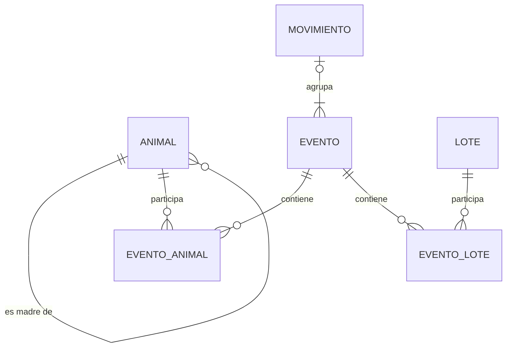
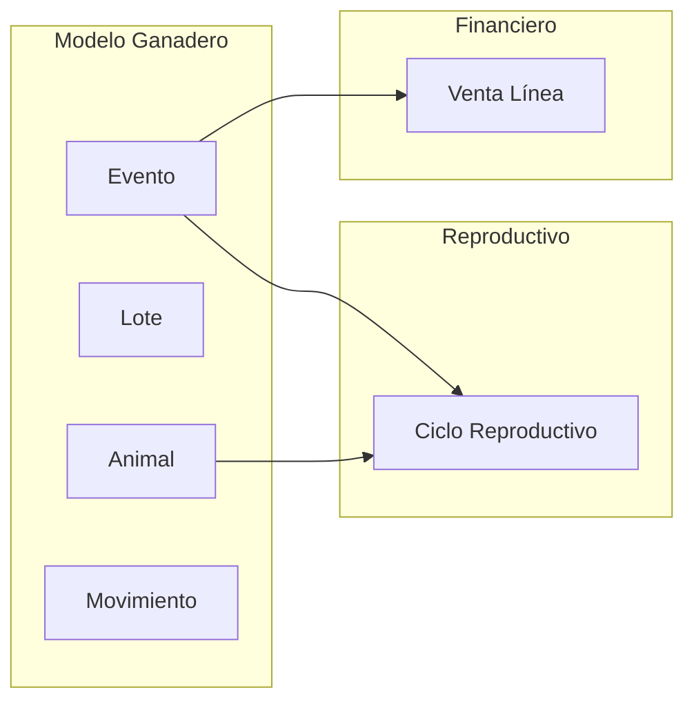
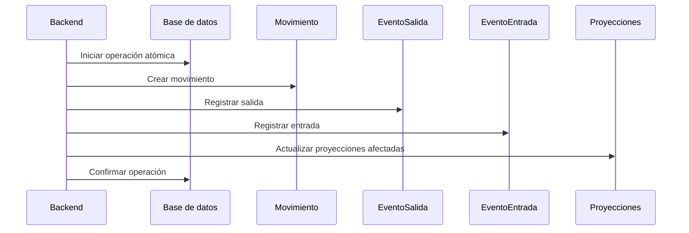

# Modelo Ganadero

## Introducción

El Modelo Ganadero constituye el núcleo conceptual sobre el que se construye toda la aplicación.

Su objetivo es representar de forma consistente la realidad física de una explotación ganadera mediante un conjunto de entidades persistentes, eventos y proyecciones derivadas que puedan ser compartidos por el resto de dominios del sistema.

Mientras que `dominios/ganadero.md` describe los principios y las reglas que gobiernan el dominio ganadero, este documento define cómo dichos conceptos se representan dentro del modelo.

El Modelo Ganadero no pretende resolver funcionalidades concretas, sino proporcionar un lenguaje común y una estructura estable sobre la que puedan construirse dominios especializados como el reproductivo, sanitario, financiero u operacional.

Por este motivo, cualquier nuevo dominio deberá reutilizar las entidades definidas en este documento antes de introducir nuevas estructuras propias.

---

# Índice

1. Objetivo
2. Principios del modelo
3. Fundamentos del modelo
4. Alcance del modelo
5. Entidades principales
   - Clasificación del modelo
   - Diagrama del modelo ganadero
   - Relaciones con otros modelos
   - Propietarios del modelo
6. Elemento central del modelo
7. Animal
   - Responsabilidades
   - Información persistente
   - Información derivada
   - Estados del animal
8. Lotes
9. Stock ganadero
10. Movimientos
11. Invariantes del modelo
12. Conclusiones
13. Relación con instalaciones y ubicaciones
14. Relación con el resto de la Base de Conocimiento

---

## Objetivo

Este documento tiene como finalidad describir el modelo conceptual persistente del Core Domain.

En él se documentan:

- las entidades fundamentales del dominio;
- las relaciones existentes entre ellas;
- las proyecciones utilizadas para facilitar la operación diaria;
- las invariantes que garantizan la coherencia del modelo;
- los límites del modelo ganadero respecto a otros dominios.

No pretende describir procesos funcionales concretos ni reglas específicas de dominios especializados como el reproductivo, sanitario o financiero.

---

## Principios del modelo

El modelo ganadero se construye sobre los principios definidos en `dominios/ganadero.md`.

Como consecuencia de dichos principios, toda representación persistente del dominio debe respetar las siguientes reglas:

- los eventos constituyen la fuente de verdad del sistema;
- las entidades representan elementos persistentes de la realidad de la explotación;
- los estados observables son proyecciones derivadas del historial de eventos;
- las decisiones de negocio forman parte del modelo cuando modifican la realidad compartida;
- cualquier estado observable debe poder reconstruirse a partir de los hechos registrados;
- ningún dominio especializado redefine los conceptos fundamentales del Core Domain.

---

# Fundamentos del modelo

El sistema NO modela únicamente entidades.

Modela:
- hechos físicos,
- evolución temporal,
- relaciones históricas.

El modelo está basado en:

```txt
EVENTOS → generan realidad derivada
```

Por tanto:

```txt
stock
estado
ciclo
situación sanitaria
```

son derivados.

* **Entidades persistentes** → representan la realidad persistente e identificable
* **Eventos** → representan su evolución
* **Proyecciones** → representan el estado observable derivado de dicha evolución

Esta separación constituye la base de todo el modelo.

---

# Alcance del modelo

Este documento describe únicamente el modelo conceptual compartido del dominio ganadero.

Las reglas específicas de los dominios especializados, como reproducción, sanidad o gestión financiera, se documentan en sus respectivos modelos, reutilizando las entidades aquí definidas.

## Qué no modela este documento

Este documento no describe la lógica de negocio de los dominios especializados ni las decisiones de implementación del sistema.

En particular, no define:

- reglas reproductivas;
- reglas sanitarias;
- procesos financieros;
- casos de uso;
- arquitectura software;
- infraestructura;
- persistencia física.

Su única responsabilidad consiste en describir la representación conceptual compartida sobre la que se apoyan dichos elementos.

---

# Objetivos del modelo

El Modelo Ganadero ha sido diseñado para cumplir los siguientes objetivos:

- representar fielmente la realidad física de la explotación;
- mantener la trazabilidad completa de todos los hechos registrados;
- permitir la reconstrucción del estado del sistema a partir de los eventos;
- proporcionar un lenguaje común para todos los dominios especializados;
- desacoplar el modelo conceptual de su implementación técnica;
- facilitar la evolución futura del sistema sin comprometer la coherencia del dominio.

---

# Entidades principales

## Clasificación del modelo

El modelo distingue entre dos grandes grupos de elementos persistentes y un conjunto de proyecciones derivadas.

### Entidades persistentes

Representan elementos identificables del modelo que mantienen información propia a lo largo del tiempo.

Se dividen en:

**Entidades núcleo (de negocio)**

Representan los conceptos fundamentales del dominio ganadero:

- Animal
- Lote
- Evento
- Movimiento

### Entidades auxiliares (catálogos)

Describen clasificaciones y elementos de contexto utilizados por el modelo:

- TipoEvento
- MotivoMovimiento
- TipoProductivo
- Raza

Son entidades persistentes, aunque su evolución y ciclo de vida son diferentes de los de las entidades núcleo.

### Entidades referenciadas de otros dominios

El modelo ganadero también mantiene referencias a entidades cuya definición y gestión corresponden a otros dominios.

Un ejemplo es `Instalación`, entidad física perteneciente al modelo de instalaciones y ubicaciones.

La ubicación de un animal se representa mediante una referencia a la instalación donde se encuentra actualmente. Por tanto, `Ubicación` es un concepto del modelo, pero no constituye una entidad física independiente.

### Proyecciones derivadas

No representan entidades ni elementos independientes de la realidad.

Representan información calculada a partir de los eventos y de las entidades persistentes, y se mantienen para facilitar las consultas del sistema.

Entre ellas se encuentran:

**Estados observables**
- Estado vital
- Estado sanitario
- Estado reproductivo
- Estado del vínculo materno

**Indicadores internos derivados**
- `es_reproductora`

**Otras proyecciones**
- Stock
- Lote actual
- Ubicación actual

Las proyecciones no constituyen fuentes de verdad independientes y deben poder reconstruirse a partir de los hechos registrados y de las reglas del dominio correspondiente.


## Diagrama del modelo ganadero

¿Cuáles son las entidades que forman el núcleo del modelo ganadero y cómo se relacionan entre sí?




El diagrama representa las relaciones conceptuales entre los elementos del modelo. Los elementos intermedios utilizados para expresar la participación de animales y lotes en los eventos no deben interpretarse necesariamente como entidades de negocio independientes. Su correspondencia con las estructuras de persistencia se define en la documentación técnica del backend.


## Relaciones con otros modelos



Las flechas representan dependencias conceptuales entre dominios, no relaciones físicas de persistencia.

## Integración con otros dominios

El Modelo Ganadero actúa como origen de la información utilizada por otros dominios especializados.

Cada dominio reutiliza las entidades del modelo sin modificar su significado.

Uno de los ejemplos más representativos es el dominio financiero.

Cuando un evento ganadero genera una operación económica, dicha relación no se establece directamente con la entidad Venta, sino mediante la entidad **Venta Línea**, que actúa como puente entre ambos modelos.

El modelo ganadero se integra con el modelo financiero mediante la entidad **Venta Línea**, que actúa como puente entre los hechos registrados en la explotación y las operaciones comerciales.

Cuando un evento representa una venta, se genera su correspondiente `venta_linea`, que mantiene la trazabilidad del hecho físico y de los animales o lotes afectados.

La relación con el modelo financiero continúa mediante la factura y la transacción:

```text
              MODELO GANADERO
                     │
              Evento de Venta
                     │
                     ▼
                Venta Línea
                     │
                     ▼
                   Venta
                     │
                     │
              MODELO FINANCIERO
                     │
          ┌──────────┴──────────┐
          ▼                     ▼
       Factura            Previsión (estimación, opcional)
          │                     │    
          ▼                     ▼     
     Transacción           Transacción    
         Real                Prevista   
```

La factura constituye la fuente de información económica real y la transacción real se genera a partir de ella para facilitar las consultas y la gestión financiera.

De forma opcional, en el momento de registrar una venta puede informarse una estimación económica. Si se utiliza esta posibilidad, se genera una transacción de previsión asociada a la venta.

Las transacciones previstas y las transacciones reales representan situaciones económicas diferentes y no deben confundirse.

Esta separación permite mantener la trazabilidad entre el hecho ganadero, la operación comercial y su documentación económica, sin introducir dependencias directas entre ambos dominios.

## Propietarios del modelo (ownership)

Cada concepto del modelo posee un único dominio propietario.

Ese dominio es el único autorizado para definir su significado y su evolución conceptual.

Los demás dominios pueden reutilizar dichos conceptos, pero nunca redefinirlos ni asumir su responsabilidad.

| Entidad            | Dominio propietario | Utilizada por                       |
| ------------------ | ------------------- | ----------------------------------- |
| Animal             | Ganadero            | Reproductivo, Sanitario, Financiero |
| Lote               | Ganadero            | Financiero                          |
| Evento             | Ganadero            | Todos los dominios                  |
| Movimiento         | Ganadero            | Ganadero                            |
| Ciclo Reproductivo | Reproductivo        | Ganadero (consulta)                 |
| Venta              | Financiero          | Financiero                          |
| Venta Línea        | Financiero          | Ganadero, Financiero                |

La utilización de una entidad por parte de otro dominio no implica que este adquiera responsabilidad sobre su definición o modificación. Cualquier operación que afecte a una entidad debe respetar las reglas y los mecanismos de escritura establecidos por su dominio propietario.

### Propiedad de la estructura y semántica de los eventos

El dominio Ganadero es propietario de la estructura común de eventos y de su integración con las entidades compartidas del modelo.

Sin embargo, la propiedad de la estructura del evento no implica que Ganadero sea responsable de definir la semántica y las reglas de negocio de todos sus tipos.

Cada dominio especializado es responsable de definir el significado, las validaciones y las consecuencias de los eventos que pertenecen a su ámbito funcional.

De esta forma se distingue entre:

- **Estructura y registro del evento:** responsabilidad del modelo Ganadero.
- **Semántica y reglas de negocio del evento:** responsabilidad del dominio propietario del hecho que representa.

## Relaciones entre entidades

Las entidades del modelo no evolucionan de forma aislada.

Su evolución queda registrada mediante eventos, que actúan como mecanismo de coordinación entre ellas.

De esta forma:

- un Animal participa en eventos;
- un Lote participa en eventos;
- un Movimiento agrupa eventos;
- las proyecciones se actualizan como consecuencia de dichos eventos.

Esta arquitectura evita dependencias directas entre entidades y garantiza que toda modificación de la realidad quede correctamente trazada.

---

# Elemento central del modelo

Aunque el modelo está formado por múltiples entidades, el Evento ocupa una posición central. 

Los animales, lotes, movimientos y el resto de conceptos describen la realidad persistente de la explotación, pero es el Evento el que registra su evolución. 

Todas las proyecciones del sistema, así como gran parte de las interacciones con otros dominios, se construyen a partir del historial de eventos.

Ninguna proyección del sistema constituye una fuente de verdad por sí misma. Todas derivan, directa o indirectamente, del historial de eventos.

Esto no convierte al Evento en la entidad principal del modelo, sino en el mecanismo mediante el cual el resto de entidades evolucionan de forma trazable.

# Animal

## Qué representa

La entidad **Animal** representa un individuo físico identificable cuya evolución puede seguirse de forma independiente a lo largo del tiempo.

Constituye la unidad básica del modelo ganadero para todas aquellas especies o fases productivas en las que es necesario realizar trazabilidad individual.

Cada animal mantiene una identidad única durante toda su vida. Su información estructural permanece estable, mientras que su estado observable evoluciona a través de los eventos registrados y se expone mediante proyecciones derivadas.

---

## Responsabilidades

La entidad Animal es responsable de representar la identidad del individuo y mantener su información persistente, tanto la que describe sus características propias como la que refleja su clasificación actual dentro de la explotación.

Entre sus principales responsabilidades se encuentran:

- mantener la identidad única del animal;
- representar sus características identificativas (especie, sexo, raza, fecha de nacimiento, identificación, etc.);
- almacenar su clasificación productiva actual;
- mantener sus relaciones genealógicas;
- servir como punto de acceso a las proyecciones derivadas utilizadas por el sistema para conocer su situación actual.

La entidad Animal no es responsable de calcular los estados derivados. Su única responsabilidad es exponer la información persistente y las proyecciones generadas a partir del historial de eventos.

---

## Información persistente

La información persistente representa aquellas características propias del animal que forman parte de su identidad o de su clasificación dentro de la explotación.

Algunos ejemplos son:

* identificación;
* especie;
* sexo;
* raza;
* fecha de nacimiento;
* tipo productivo;
* genealogía.

La información persistente no es necesariamente inmutable. Algunos datos, como la clasificación productiva, pueden cambiar como consecuencia de decisiones de negocio válidas. Estos cambios deben realizarse mediante las operaciones correspondientes y respetar las reglas del dominio.

### Cambio de tipo productivo

La modificación del tipo productivo constituye una decisión de negocio que altera el papel del animal dentro de la explotación.

Todo cambio efectivo de tipo productivo debe registrarse mediante un evento `CAMBIO_TIPO_PRODUCTIVO`, que representa el hecho real de la decisión del ganadero.

El evento conserva la trazabilidad del cambio, incluyendo el tipo productivo anterior y el nuevo.

Las consecuencias sobre otros elementos del modelo, como la entrada o salida del dominio reproductivo y la apertura o cierre de ciclos, se ejecutan dentro de la misma operación de negocio y respetan las reglas del dominio correspondiente.

El cambio de tipo productivo no debe confundirse con una corrección de datos introducidos incorrectamente. Cada caso utiliza su mecanismo específico de registro y trazabilidad.

Las reglas completas de elegibilidad, transiciones permitidas y consecuencias de este flujo se documentan en `cambio_tipo_productivo.md`.

### Genealogía

La genealogía forma parte de la identidad histórica del animal.

La relación con su madre se representa mediante `madre_id`.

`madre_id` identifica de forma permanente a la madre conocida del animal y es independiente de cualquier relación funcional posterior entre ambos.

La finalización de un vínculo materno no modifica ni elimina `madre_id`.

Por tanto:

```text
madre_id
    ↓
relación genealógica permanente
```

La existencia de `madre_id` no implica que la cría continúe dependiendo funcionalmente de su madre.

---

## Información derivada

Además de la información persistente, la entidad Animal expone proyecciones derivadas que permiten consultar su situación actual sin reconstruir continuamente el historial completo.

Estas proyecciones no constituyen fuentes de verdad independientes y nunca deben modificarse manualmente.

Se calculan a partir de los eventos registrados, la información persistente relevante y las reglas de negocio del dominio propietario de cada concepto.

Cuando una proyección depende exclusivamente de eventos, debe poder reconstruirse a partir del historial correspondiente. Cuando también depende de datos persistentes, su reconstrucción debe contemplar igualmente dichos datos y las reglas aplicables.

Entre ellas se encuentran:

**Estados observables**
- Estado vital.
- Estado sanitario.
- Estado reproductivo.
- Estado del vínculo materno.

**Otras proyecciones**
- Lote actual.
- Ubicación actual.

El detalle de los estados observables se desarrolla en el apartado siguiente. Las proyecciones de lote y ubicación representan la situación actual del animal dentro de la organización física de la explotación.

El backend es responsable de mantener las proyecciones sincronizadas con los eventos y las reglas del dominio correspondiente.

### Estado del vínculo materno

El estado del vínculo materno representa el conocimiento actual del sistema sobre la existencia de una dependencia funcional entre una cría y su madre.

Se representa mediante el campo técnico `estado_vinculo_materno`.

Este estado es independiente de `madre_id`.

Mientras `madre_id` representa una relación genealógica permanente, `estado_vinculo_materno` representa una situación funcional que puede finalizar durante la vida del animal.

El estado del vínculo materno puede adoptar los siguientes valores:

| Valor        | Significado                                                                                                    |
| ------------ | -------------------------------------------------------------------------------------------------------------- |
| `NULL`       | El sistema no dispone de información suficiente para determinar la existencia de un vínculo materno funcional. |
| `ACTIVO`     | El sistema conoce la existencia de un vínculo materno funcional vigente.                                       |
| `FINALIZADO` | El sistema conoce que el vínculo materno funcional ha terminado.                                               |

`estado_vinculo_materno` es una proyección derivada persistida.

No constituye una fuente de verdad independiente de los eventos y no debe ser editable por el usuario.

El detalle de las reglas que determinan su creación, evolución y finalización pertenece al dominio reproductivo y se documenta en `modelo_reproductivo.md`.

---

## Estados del animal

El Animal expone diferentes estados observables que representan una proyección de su situación actual.

Estos estados no forman parte de su identidad estructural. Se derivan de los eventos registrados y de las reglas definidas por el dominio propietario de cada concepto.

El modelo ganadero proporciona el soporte común para exponerlos, pero no asume la responsabilidad de definir las reglas específicas de los dominios especializados.

Todos ellos deben poder reconstruirse a partir de los hechos registrados y de las reglas correspondientes.

---

### Estado vital

Representa la situación del animal respecto a su permanencia dentro de la explotación.

| Estado | Significado |
|--------|-------------|
| VIVO | Animal del que no consta un fallecimiento ni una venta. |
| VENDIDO | Animal cuya salida de la explotación se ha registrado como venta. |
| MUERTO | Animal cuyo fallecimiento se ha registrado. |

El estado vital representa la situación conocida del animal respecto a su vida y a su salida de la explotación. Tiene prioridad sobre el resto de estados observables. Condiciona las operaciones disponibles, pero no elimina los estados históricos de otros dominios.

Cuando un animal pasa a estado `VENDIDO` o `MUERTO`, deja de estar disponible para las operaciones ordinarias que requieren un animal activo en la explotación. Sin embargo, su identidad, historial, relaciones genealógicas y demás información necesaria para mantener la trazabilidad deben conservarse íntegramente.

---

### Estado sanitario

Representa la situación sanitaria observable del animal en un momento determinado. 

Algunos ejemplos de estado sanitario, cuyas reglas se definen en el dominio sanitario, son:

| Estado | Significado |
|--------|-------------|
| SANO | Sin incidencias sanitarias registradas. |
| EN_OBSERVACION | Existe una incidencia pendiente de evaluación. |
| EN_TRATAMIENTO | El animal está sometido a un tratamiento activo. |
| NO_APTO | El animal queda temporal o permanentemente fuera del circuito productivo por motivos sanitarios. |

El estado sanitario evoluciona de forma independiente al resto de estados del animal y deriva exclusivamente de los eventos sanitarios registrados.

---

### Estado reproductivo

Representa la situación biológica conocida y observable del animal dentro del ciclo reproductivo, a partir de los eventos registrados y de las reglas del dominio reproductivo.

A diferencia del estado vital o sanitario, el estado reproductivo únicamente existe para aquellos animales que participan en el dominio reproductivo.

La participación en dicho dominio no depende de un hecho biológico, sino de una decisión de negocio representada mediante el **tipo productivo**. En particular, cuando se ejecuta una operación de cambio de tipo productivo que supone pasar a REPRODUCTORA. Con ello se crea siempre un nuevo ciclo reproductivo en estado VACÍA.

Esta operación también se aplica cuando una hembra que anteriormente había dejado de ser reproductora vuelve a incorporarse al dominio. Nunca se reabre un ciclo anterior.

Cuando a un animal se le asigna el tipo productivo **REPRODUCTORA**, pasará a participar del dominio reproductivo y su estado reproductivo evoluciona exclusivamente mediante los eventos reproductivos registrados.

| Estado | Significado |
|--------|-------------|
| VACÍA | La hembra participa en el dominio reproductivo y no consta una gestación en curso. |
| CUBIERTA | Se ha registrado una cubrición, pero la gestación todavía no ha sido confirmada. |
| GESTANTE | Existe una gestación confirmada. |

El estado reproductivo es una proyección derivada. No se modifica directamente ni pretende inferir hechos biológicos que no hayan sido registrados.

La asignación del tipo productivo REPRODUCTORA determina la participación de la hembra en el dominio reproductivo. La creación y evolución de los ciclos se rigen por las reglas específicas del dominio reproductivo.

La lactancia no constituye un estado reproductivo. La existencia de crías que mantienen una dependencia funcional activa respecto de su madre se representa mediante estado_vinculo_materno y se interpreta en el contexto del ciclo reproductivo que contiene el Parto que originó dichas crías.

Por tanto, el estado reproductivo de la madre no debe confundirse con la existencia de dependencias funcionales activas. Una madre puede tener un ciclo reproductivo actual y, al mismo tiempo, mantener dependencias originadas por un Parto anterior.

El detalle completo del ciclo reproductivo, sus transiciones y sus reglas de negocio se documenta en **modelo_reproductivo.md**.

---

## Separación entre clasificación productiva y estado reproductivo

El modelo distingue entre la clasificación productiva de un animal y su situación reproductiva conocida.

El **tipo productivo** representa una decisión de negocio sobre el papel que desempeña el animal dentro de la explotación. Es información persistente que puede cambiar mediante operaciones de negocio válidas.

El **estado reproductivo** representa el conocimiento que tiene el sistema sobre la situación reproductiva actual del animal, a partir de los eventos registrados y de las reglas del dominio reproductivo.

Ambos conceptos tienen significados diferentes, aunque mantienen una relación de dependencia:

- **Tipo productivo:** ¿Qué función desempeña este animal dentro de la explotación?
- **Estado reproductivo:** ¿Qué situación reproductiva conoce actualmente el sistema sobre este animal?

Solo las hembras clasificadas como `REPRODUCTORA` pueden participar en el dominio reproductivo.

El indicador interno `es_reproductora` se calcula mediante la siguiente regla:

```text
es_reproductora =
    (sexo = 'hembra')
    AND
    (tipo_productivo = 'REPRODUCTORA')
```

Como consecuencia:

- Una hembra clasificada como `REPRODUCTORA` implica `es_reproductora = true`.
- Cualquier otro caso implica `es_reproductora = false`, incluidos los animales cuyo sexo todavía no está identificado.
- Si `es_reproductora = false`, `estado_reproductivo` debe ser `NULL`.
- Si `es_reproductora = true`, el animal es elegible para participar en el dominio reproductivo. La existencia de un ciclo y la determinación de su estado reproductivo se rigen por las operaciones y reglas específicas de dicho dominio.

La asignación del tipo productivo `REPRODUCTORA` a un macho no constituye una clasificación válida y debe rechazarse mediante las validaciones correspondientes.

`es_reproductora` es un indicador interno derivado por el backend. No constituye una clasificación adicional editable por el usuario.

Esta separación permite representar las decisiones productivas de la explotación sin confundirlas con la evolución reproductiva del animal.

El detalle de las reglas de elegibilidad y del funcionamiento del ciclo reproductivo se documenta en `modelo_reproductivo.md`.

---

# Lotes

## Qué representan

La entidad **Lote** representa una agrupación de animales utilizada para facilitar su organización y gestión dentro de la explotación.

Un lote no constituye una unidad biológica ni representa necesariamente un espacio físico concreto. Su finalidad responde a necesidades organizativas, productivas, sanitarias o logísticas.

La pertenencia de un animal a un lote puede cambiar a lo largo de su vida sin que ello afecte a su identidad ni a su genealogía.

El lote y la ubicación física son conceptos independientes:

- **Lote:** identifica la agrupación organizativa o productiva a la que pertenece el animal.
- **Ubicación:** identifica dónde se encuentra físicamente el animal dentro de la explotación.

Por tanto, un cambio de lote no implica necesariamente un cambio de ubicación, y un cambio de ubicación no implica necesariamente un cambio de lote.

---

## Responsabilidades

La entidad Lote permite:

- agrupar animales para facilitar su gestión;
- identificar el origen o destino de operaciones de incorporación y salida de animales;
- consultar la cantidad de animales que pertenecen a cada agrupación;
- facilitar la selección de conjuntos de animales para operaciones masivas.

El lote no constituye la fuente de verdad de su composición. Esta se deriva del historial de eventos que modifican la pertenencia de los animales a los lotes.

La gestión de la ubicación física de los animales corresponde al modelo de instalaciones y ubicaciones, no a la entidad Lote.

---

## Tipos de lote

El modelo no impone una clasificación cerrada de lotes.

Cada especie o sistema productivo podrá definir los tipos de lote que necesite siempre que respeten el modelo general.

Ejemplos habituales son:

| Tipo | Finalidad |
|--------|-----------|
| Camada | Agrupar animales recién nacidos. |
| Post-destete | Agrupar animales durante la transición tras el destete. |
| Engorde | Agrupar animales destinados a la fase de engorde. |
| Cuarentena | Agrupar animales aislados temporalmente por motivos sanitarios. |

La incorporación de nuevos tipos de lote no requiere modificar el modelo conceptual.

---

# Stock ganadero

## Qué representa

El **stock ganadero** representa la cantidad de animales pertenecientes a un determinado lote en un instante concreto.

Es una proyección derivada cuyo objetivo es optimizar las consultas operativas del sistema.

Este concepto se refiere exclusivamente a la cantidad de animales agrupados en lotes. No debe confundirse con el stock de productos o materiales almacenados en las instalaciones, que pertenece al ámbito de gestión de inventario.

## Fuente de verdad

El stock ganadero nunca constituye una fuente de verdad independiente.

La composición de un lote se deriva del historial de eventos que afectan a la pertenencia de los animales a dicho lote.

La proyección de stock permite consultar esta información de forma eficiente sin tener que reconstruir el historial completo en cada consulta.

## Cálculo

Conceptualmente, el stock de un lote puede representarse como:

```txt
Stock actual =
Stock inicial
+ Incorporaciones
− Salidas
± Ajustes
```

El cálculo debe contemplar todos los eventos que puedan modificar la composición del lote, independientemente del dominio al que pertenezcan.

Por tanto, no debe limitarse exclusivamente a eventos genéricos de entrada y salida.

La fórmula expresa el efecto neto de los cambios sobre la composición del lote. La implementación concreta del algoritmo puede evolucionar sin modificar este modelo conceptual.

---

# Movimientos

## Qué representan

La entidad **Movimiento** representa una operación lógica que agrupa varios eventos relacionados entre sí cuando resulta necesario mantener una trazabilidad común de la operación.

Su objetivo es identificar y contextualizar operaciones que implican varios cambios coordinados dentro de la explotación.

Un movimiento no constituye un evento ni sustituye a los eventos que representan los hechos producidos.

Tampoco es obligatorio que todos los eventos estén asociados a un movimiento. Los eventos que representan hechos independientes pueden registrarse sin necesidad de crear una agrupación adicional.

El movimiento no modifica directamente el estado del sistema. Los cambios se producen mediante los eventos asociados.

La entidad Movimiento no debe confundirse con un cambio de ubicación física.

En el modelo ganadero, los movimientos entre lotes representan operaciones que modifican la pertenencia de los animales a agrupaciones organizativas o productivas.

Los cambios de ubicación física pertenecen al modelo de instalaciones y ubicaciones y se registran mediante el evento `CAMBIO_UBICACION`.

Por tanto, una reubicación física no requiere crear una entidad Movimiento ni generar eventos de salida y entrada de lote, salvo que la operación incluya también un cambio efectivo de pertenencia a un lote.

## Ejemplo conceptual

Un cambio de pertenencia de animales entre dos lotes se representa mediante dos eventos:

```text
Salida del lote origen
Entrada en el lote destino
```

Cuando ambos eventos forman parte de una misma operación, quedan vinculados mediante un único `movimiento_id`.

El movimiento representa la operación de traslado entre agrupaciones, mientras que cada evento conserva su significado individual.

Esta operación no implica necesariamente un cambio de ubicación física.

Por otro lado, cuando un animal cambia de instalación o ubicación física sin cambiar de lote, la operación se registra mediante `CAMBIO_UBICACION`, sin crear un movimiento entre lotes.

Si una operación implica simultáneamente un cambio de lote y un cambio de ubicación, deberán registrarse ambos hechos mediante los mecanismos correspondientes, respetando las reglas de cada dominio.

## Responsabilidades

La entidad Movimiento es responsable de:

- agrupar eventos relacionados cuando una operación lo requiere;
- mantener la trazabilidad conjunta de operaciones compuestas;
- facilitar auditorías posteriores;
- permitir identificar los eventos que forman parte de una misma operación.

El movimiento no constituye una fuente de verdad independiente del historial de eventos. Su información contextualiza y agrupa los hechos registrados, pero no los sustituye.

Un movimiento sin eventos asociados carece de significado como operación de negocio.

## Relación entre movimientos y eventos

La siguiente secuencia ilustra una posible implementación conceptual de un traslado entre lotes.



La secuencia representa una única unidad lógica de ejecución. Si cualquiera de los pasos necesarios falla, la operación completa debe revertirse, evitando que quede registrada únicamente una parte del traslado.

El orden interno de ejecución podrá variar según la implementación, siempre que se preserve la atomicidad de la operación y la consistencia del modelo.

La actualización de las proyecciones es responsabilidad del backend y debe realizarse de acuerdo con las reglas del dominio correspondiente.

---

# Relación con instalaciones y ubicaciones

El modelo ganadero distingue entre la agrupación organizativa de animales y su ubicación física.

La pertenencia a un lote y la ubicación actual de un animal son dimensiones independientes de su situación dentro de la explotación.

El modelo de instalaciones y ubicaciones es responsable de definir:

- las instalaciones y sus características;
- los usos operativos permitidos de cada instalación;
- el concepto de ubicación y su relación con las instalaciones;
- la asignación y modificación de la ubicación física de los animales;
- el historial de cambios de ubicación;
- las reglas de validación asociadas a las reubicaciones.

El modelo contempla también la futura posibilidad de asociar ubicaciones a lotes, pero su comportamiento y operativa específica deberán definirse en el desarrollo correspondiente.

Los cambios de ubicación de animales se registran mediante el evento `CAMBIO_UBICACION`. Este evento no debe confundirse con los eventos de salida y entrada utilizados para modificar la pertenencia a lotes.

El detalle conceptual de este modelo se desarrolla en `modelo_instalaciones_y_ubicaciones.md`.

---

# Invariantes del modelo

Las siguientes reglas forman parte del modelo conceptual y deben cumplirse independientemente de la tecnología utilizada para implementarlo.

## Trazabilidad

Toda modificación de la realidad operativa de la explotación debe quedar registrada mediante uno o varios eventos.

Los eventos representan hechos de negocio que han ocurrido y constituyen la fuente de verdad para reconstruir la evolución de la explotación.

No toda modificación de un dato persistente constituye un evento de negocio.

Las correcciones de información descriptiva o identificativa, como un crotal, una fecha o una raza introducidos incorrectamente, pueden realizarse mediante operaciones de corrección de datos, siempre que quede constancia auditable del cambio.

El sistema debe distinguir entre:

- **Registro de un hecho:** representa algo que ha ocurrido en la explotación y debe quedar reflejado mediante un evento.
- **Corrección de información:** modifica un dato persistente que fue introducido incorrectamente, conservando la trazabilidad de la corrección.

Una corrección de datos no debe generar artificialmente un evento de negocio que represente un hecho que nunca ocurrió.

---

## Consistencia

Las proyecciones nunca constituyen la fuente de verdad de los hechos de negocio.

Su objetivo es facilitar las consultas del sistema y representar de forma eficiente la situación observable de la explotación.

Las proyecciones derivadas de eventos deben mantenerse sincronizadas con el historial de eventos y las reglas del dominio correspondiente.

En caso de discrepancia entre una proyección y los hechos de negocio registrados, prevalece el historial de eventos y la proyección debe poder corregirse o reconstruirse.

Los datos persistentes que no sean proyecciones derivadas, como la información identificativa del animal o los datos maestros, mantienen sus propias reglas de persistencia y corrección.

---

## Integridad

Las relaciones entre entidades deben mantenerse siempre consistentes.

No pueden existir referencias a entidades inexistentes ni operaciones que dejen el modelo en un estado inválido.

---

## Genealogía

La relación genealógica representada mediante `madre_id` es independiente de los estados funcionales derivados del animal.

Cuando `madre_id` identifica una madre conocida:

* la relación genealógica se conserva durante toda la vida del animal;
* la finalización de un vínculo materno no modifica `madre_id`;
* ningún evento de Destete, Venta o Muerte debe eliminar ni sustituir la relación genealógica.

El modelo debe distinguir siempre entre:

```text
madre_id
    ↓
genealogía

estado_vinculo_materno
    ↓
dependencia funcional
```

La existencia de una relación genealógica no implica que exista actualmente una dependencia funcional entre ambos animales.


---

## Atomicidad

Las operaciones de negocio que requieren registrar varios eventos relacionados como una única operación lógica deben ejecutarse de forma atómica.

El sistema nunca debe dejar registrada únicamente una parte de una operación que requiera consistencia conjunta.

Si cualquiera de los pasos necesarios falla, deben revertirse los cambios realizados dentro de esa operación, incluyendo los eventos, el movimiento asociado cuando exista y las actualizaciones de las proyecciones correspondientes.

La atomicidad debe garantizarse en el backend, independientemente de la implementación tecnológica utilizada.

---

## Reconstrucción

Las proyecciones derivadas de eventos deben poder reconstruirse a partir del historial de eventos registrados y de las reglas de negocio correspondientes.

La pérdida de una proyección no debe implicar la pérdida de información de negocio.

El modelo distingue entre:

- **Hechos de negocio:** registrados mediante eventos, que permiten reconstruir la evolución de la explotación.
- **Datos persistentes:** información propia de las entidades y catálogos, gestionada mediante sus mecanismos de persistencia y corrección.
- **Proyecciones derivadas:** representaciones calculadas a partir de los hechos registrados y las reglas del dominio.

La reconstrucción de una proyección debe respetar esta separación y no debe confundirse con la reconstrucción de todos los datos persistentes de la aplicación.

---

# Conclusiones

El Modelo Ganadero constituye la base conceptual compartida sobre la que se construyen los distintos dominios funcionales de la aplicación.

Su objetivo no es describir procesos concretos ni implementar reglas específicas de negocio, sino proporcionar una representación consistente, trazable y evolutiva de la realidad de la explotación.

Para ello distingue entre:

- entidades persistentes;
- eventos que describen los hechos y la evolución del negocio;
- proyecciones derivadas utilizadas para consultar la situación actual;
- agrupaciones lógicas de operaciones cuando resulta necesario mantener una trazabilidad conjunta.

El modelo diferencia también conceptos que, aunque relacionados, tienen responsabilidades distintas:

- La pertenencia a un lote representa una agrupación organizativa o productiva.
- La ubicación representa la posición física de un animal o recurso dentro de la explotación.
- El movimiento permite agrupar eventos relacionados cuando una operación lo requiere.
- El cambio de ubicación se registra mediante los mecanismos específicos del modelo de instalaciones y ubicaciones.

Esta separación permite que cada dominio mantenga sus propias reglas y responsabilidades sin duplicar conceptos ni introducir dependencias innecesarias.

El resultado es un modelo compartido que facilita la evolución independiente de los dominios especializados y mantiene la coherencia global de la aplicación.

---

## Relación con el resto de la Base de Conocimiento

Este documento define el modelo conceptual compartido del dominio ganadero.

Los documentos especializados amplían este modelo sin redefinir sus conceptos fundamentales.

Entre ellos destacan:

- `dominios/ganadero.md`, que describe los principios del dominio ganadero.
- `modelo_reproductivo.md`, que desarrolla el modelo conceptual del dominio reproductivo.
- `modelo_instalaciones_y_ubicaciones.md`, que desarrolla el modelo conceptual de instalaciones, ubicaciones operativas y reubicaciones.
- `cambio_tipo_productivo.md`, que desarrolla las reglas y el flujo de negocio para modificar la clasificación productiva de un animal.
- `backend_spec.md`, que documenta la implementación técnica y la persistencia del modelo.
- `frontend_spec.md`, que describe la representación del modelo en la interfaz de usuario.

Todos ellos deben interpretarse como especializaciones o implementaciones del presente modelo, nunca como definiciones alternativas del mismo.

---

# Referencias

Dominio relacionado

- documentacion/dominios/ganadero.md

Modelos relacionados

- documentacion/modelo/modelo_reproductivo.md
- documentacion/modelo/modelo_instalaciones_y_ubicaciones.md

Arquitectura

- documentacion/arquitectura/overview.md